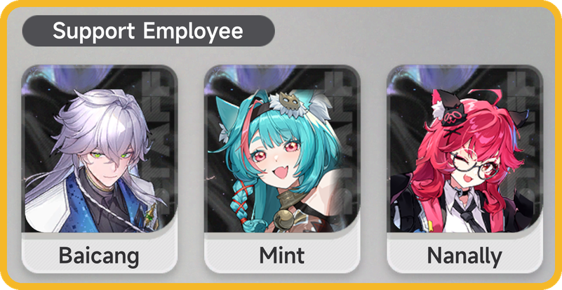

# NTE AutoCafe 1-1

[English](README.md) · **Español**

Bot portable para Windows que juega la **etapa 1-1 del minijuego de la cafetería** en *Neverness to Everness (NTE)*. Mira la pantalla con OpenCV, juega la etapa solo y la repite hasta que se acaba tu stamina.


## Características

- **App visual y portable.** Un solo `.exe` con ventana: no hay que instalar nada ni usar consola.
- **Ciclo completo:** menú de la etapa → 1-1 → *Open Shop* → martillo a cada cliente → *Salir* → *Claim* → repetir.
- **Se detiene solo** cuando se gasta tu stamina (stamina ÷ costo por ronda).
- **Clics humanizados:**
  - espera entre 1 y 3 s desde que aparece un cliente antes de usar el martillo
  - mueve el mouse en curvas que arrancan rápido y frenan al llegar
  - hace clic en un punto al azar dentro de cada botón y mantiene cada presión un tiempo distinto
  - varía las pausas y de vez en cuando se toma un descanso más largo entre rondas
- **Pantalla completa o ventana**, en cualquier resolución 16:9 desde 4K hasta 720p. En modo ventana sigue al juego aunque muevas la ventana.
- **Vista en vivo** de lo que detecta el bot y registro de actividad.
- Interfaz en **inglés o español** (inglés por defecto).
- **Modo solo observar** para probar sin clics, atajos F9 / F8 y freno de emergencia en la esquina.

## Requisitos

- Windows 10/11 (64 bits).
- **Baicang, Mint y Nanally equipados como Support Employees** en la etapa 1-1 (en cualquier orden). Toda la estrategia del bot es el martillo 100T, y eso solo alcanza la meta de Revenue con este equipo. **Sin estos tres no funciona.**

<p align="center"></p>

## Descarga

Baja el último `NTE-AutoCafe1-1-vX_Y_Z-Windows-x64.exe` desde **[Releases](https://github.com/Kirizanai/NTE-AutoCafe1-1/releases/latest)** y ábrelo. No requiere instalación.

## Cómo usarlo

1. Abre el juego en el **menú de la etapa 1-1** (la pantalla *Owner's Selection*) y confirma que tus Support Employees sean **Baicang, Mint y Nanally**. Si no, cámbialos con *Swap Employee*.
2. Abre el `.exe` y acepta el aviso de administrador: hace falta para que los clics le lleguen al juego.
3. Escribe tu **stamina actual**. La app te muestra cuántas rondas salen.
4. Si juegas **en ventana**, pulsa **Buscar** y elige la ventana del juego. Para pantalla completa, deja **Pantalla completa**.
5. Pulsa **INICIAR**, o **F9** desde el juego. **F8** lo detiene, y también llevar el mouse a la **esquina superior izquierda** de la pantalla.
   - En pantalla completa, INICIAR te da 5 s para cambiar al juego.
   - En modo ventana, trae el juego al frente solo.

> **La primera vez:** activa **Solo observar (no hace clics)** y juega una ronda tú. Cuando el contador llegue a 132/100, el registro debería decir `Revenue: 3 dígito(s)`. Si es así, desactiva el modo observar y déjalo trabajar.

## Cómo funciona

El bot toma una captura unas 10 veces por segundo y reconoce en qué pantalla está:

| Pantalla | Cómo la reconoce |
| --- | --- |
| Menú de la etapa | Busca la plantilla del botón *Open Shop* y el título de la etapa, para asegurarse de que está seleccionada la 1-1 |
| Cuenta atrás / transiciones | No reconoce nada, así que espera |
| En partida | La barra verde del tiempo arriba |
| Cliente | El aro dorado de la burbuja de pedido (tono y tamaño exactos) |
| Meta cumplida | El número naranja de Revenue llega a 3 dígitos (39 → 83 → 132), o la primera estrella se pone dorada |
| Recompensa | Busca la plantilla del botón *Claim* |

Todas las posiciones están definidas sobre una referencia de 3840×2160 y se escalan al área capturada. Por eso funciona en cualquier resolución 16:9.

**Respaldos:**
- Si no detecta clientes en 6 s, usa el martillo a intervalos fijos.
- Si no detecta la meta dentro del tiempo límite, sale de la etapa igual.
- Si no reconoce la pantalla durante 60 s, se detiene y guarda una captura en la carpeta `capturas`.

## Ajustes

| Ajuste | Por defecto | Descripción |
| --- | --- | --- |
| Idioma | English | Idioma de la interfaz y del registro |
| Stamina actual | 472 | Tu stamina al empezar |
| Costo por ronda | 18 | Stamina que cobra cada *Claim* |
| Juego en | Pantalla completa | Pantalla completa, o la ventana del juego si juegas en ventana |
| Clics humanizados | Activado | Tiempos al azar, recorridos curvos y punto de clic aleatorio |
| Solo observar | Desactivado | Detecta y registra, pero nunca hace clic |
| Avanzado → Monitor | 1 | Monitor que usa en pantalla completa |
| Avanzado → Reacción | 1.00 – 3.00 s | Espera entre que aparece un cliente y el martillazo |
| Avanzado → Pausa martillo | 0.40 s | Tiempo mínimo entre martillazos (al azar, hasta el doble) |
| Avanzado → Máx. por partida | 45 s | Tiempo límite para salir de la etapa si no detecta la meta |

Los ajustes se guardan en `ajustes.json` y el registro en `registro.txt`, ambos junto al `.exe`.

## Problemas comunes

- **Usa el martillo pero nunca llega a la meta:** revisa que Baicang, Mint y Nanally estén equipados como Support Employees.
- **Aviso de Windows SmartScreen:** el `.exe` no está firmado. Pulsa *Más información* → *Ejecutar de todas formas*.
- **Los clics no hacen nada:** deja el juego visible (sin ventanas encima) y acepta el aviso de administrador.
- **La vista en vivo sale negra:** cambia el juego a modo sin bordes o ventana.
- **Se detiene con "Pantalla no reconocida":** revisa la captura guardada en `capturas`. Muestra lo que estaba viendo el bot.
- **Los clics caen en otro lugar:** el área del juego tiene que ser 16:9.

## Compilar desde el código

Requisitos: Windows 10/11 y Python 3.11.

```bat
pip install -r requirements.txt
build.bat
```

El ejecutable queda en `dist\`. Para usarlo sin compilar: `python app.py`.

| Archivo | Contenido |
| --- | --- |
| `app.py` | Ventana y controles (Dear PyGui) |
| `nucleo.py` | Captura de pantalla, detección con OpenCV, clics humanizados y el ciclo del bot |
| `i18n.py` | Textos en inglés y español |
| `plantillas/` | Imágenes de referencia que busca el bot |

## Aviso

Este es un proyecto no oficial hecho por un fan. No está afiliado ni respaldado por los desarrolladores o distribuidores de *Neverness to Everness*. Automatizar el juego puede infringir sus términos de servicio y causar sanciones en tu cuenta. Úsalo bajo tu propia responsabilidad.

## Licencia

[MIT](LICENSE)
