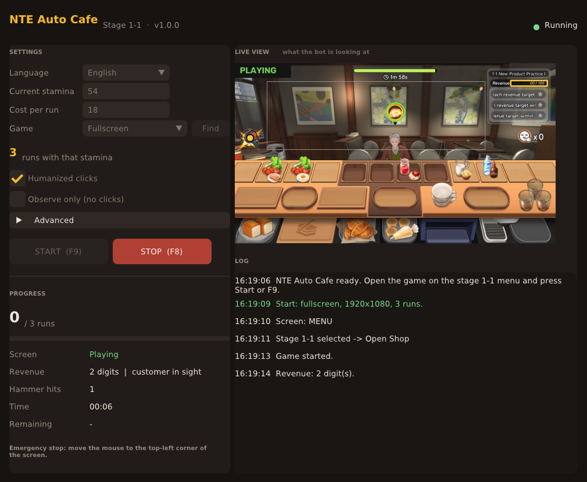

# NTE AutoCafe 1-1

**English** · [Español](README.es.md)

A portable Windows bot for the **stage 1-1 café minigame** in *Neverness to Everness (NTE)*. It watches the screen with OpenCV, plays the stage by itself and repeats it until your stamina runs out.



## Features

- **Fully visual, portable app.** A single `.exe` with a window: nothing to install, no console.
- **Full loop:** stage menu → 1-1 → *Open Shop* → hammer every customer → *Exit* → *Claim* → repeat.
- **Stops by itself** when your stamina is used up (stamina ÷ cost per run).
- **Humanized input:**
  - waits 1–3 s after a customer appears before using the hammer
  - moves the mouse along curved paths that start fast and slow down near the target
  - clicks a random point inside each button and holds each press for a different time
  - varies the pauses and occasionally takes a longer break between runs
- **Fullscreen or windowed**, at any 16:9 resolution from 4K down to 720p. In windowed mode it follows the game window when you move it.
- **Live view** of what the bot is detecting, plus an activity log.
- **English / Spanish** interface (English by default).
- **Observe-only mode** for testing without clicks, F9 / F8 hotkeys and an emergency stop corner.

## Download

Get the latest `NTE-AutoCafe1-1-vX_Y_Z-Windows-x64.exe` from **[Releases](https://github.com/Kirizanai/NTE-AutoCafe1-1/releases/latest)** and run it. No installation needed.

## How to use

1. Open the game on the **stage 1-1 menu** (the *Owner's Selection* screen).
2. Run the `.exe`. Accept the administrator prompt: it is needed so the clicks reach the game.
3. Type your **current stamina**. The app shows how many runs that is.
4. If you play **windowed**, press **Find** and pick the game window. For fullscreen, leave **Fullscreen** selected.
5. Press **START**, or **F9** from inside the game. **F8** stops it, and so does moving the mouse to the **top-left corner** of the screen.
   - In fullscreen mode, START gives you 5 s to switch to the game.
   - In windowed mode, it brings the game to the front by itself.

> **First time:** turn on **Observe only (no clicks)** and play one round yourself. When the counter reaches 132/100, the log should say `Revenue: 3 digit(s)`. If it does, turn observe-only off and let it run.

## How it works

The bot takes a screenshot about 10 times per second and figures out which screen it is on:

| Screen | How it is recognized |
| --- | --- |
| Stage menu | Template match of the *Open Shop* button, plus the stage title to make sure 1-1 is selected |
| Countdown / transitions | Nothing recognized, so it waits |
| In game | The green timer bar at the top |
| Customer | The gold ring of the order bubble (exact hue and size) |
| Goal reached | The orange Revenue number reaches 3 digits (39 → 83 → 132), or the first star turns gold |
| Reward | Template match of the *Claim* button |

All positions are defined on a 3840×2160 reference and scaled to the captured area. That is why any 16:9 resolution works.

**Safety nets:**
- If no customer is detected for 6 s, it uses the hammer at fixed intervals.
- If the goal is not detected within the time limit, it exits the stage anyway.
- If the screen is not recognized for 60 s, it stops and saves a screenshot to the `capturas` folder.

## Settings

| Setting | Default | Description |
| --- | --- | --- |
| Language | English | Interface and log language |
| Current stamina | 472 | Your stamina when you start |
| Cost per run | 18 | Stamina charged by each *Claim* |
| Game | Fullscreen | Fullscreen, or the game window when playing windowed |
| Humanized clicks | On | Random timing, curved mouse paths and random click points |
| Observe only | Off | Detects and logs, but never clicks |
| Advanced → Monitor | 1 | Monitor used in fullscreen mode |
| Advanced → Reaction | 1.00 – 3.00 s | Delay between a customer appearing and the hammer hit |
| Advanced → Hammer pause | 0.40 s | Minimum time between hammer hits (randomized up to twice as long) |
| Advanced → Max per run | 45 s | Time limit before exiting a stage when the goal is not detected |

Settings are saved to `ajustes.json` and the log to `registro.txt`, both next to the `.exe`.

## Troubleshooting

- **Windows SmartScreen warning:** the `.exe` is not code-signed. Click *More info* → *Run anyway*.
- **Clicks do nothing:** keep the game visible (no window on top of it) and accept the administrator prompt.
- **The live view is black:** switch the game to borderless or windowed mode.
- **It stops with "Unrecognized screen":** look at the screenshot saved in `capturas`. It shows what the bot was seeing.
- **Clicks land in the wrong place:** the game area must be 16:9.

## Build from source

Requirements: Windows 10/11 and Python 3.11.

```bat
pip install -r requirements.txt
build.bat
```

The executable is created in `dist\`. To run it without building, use `python app.py`.

| File | Contents |
| --- | --- |
| `app.py` | Window and controls (Dear PyGui) |
| `nucleo.py` | Screen capture, OpenCV detection, humanized input and the bot loop |
| `i18n.py` | English and Spanish texts |
| `plantillas/` | Image templates the bot looks for |

## Disclaimer

This is an unofficial fan project. It is not affiliated with or endorsed by the developers or publishers of *Neverness to Everness*. Automating gameplay may violate the game's terms of service and could lead to penalties on your account. Use it at your own risk.

## License

[MIT](LICENSE)
